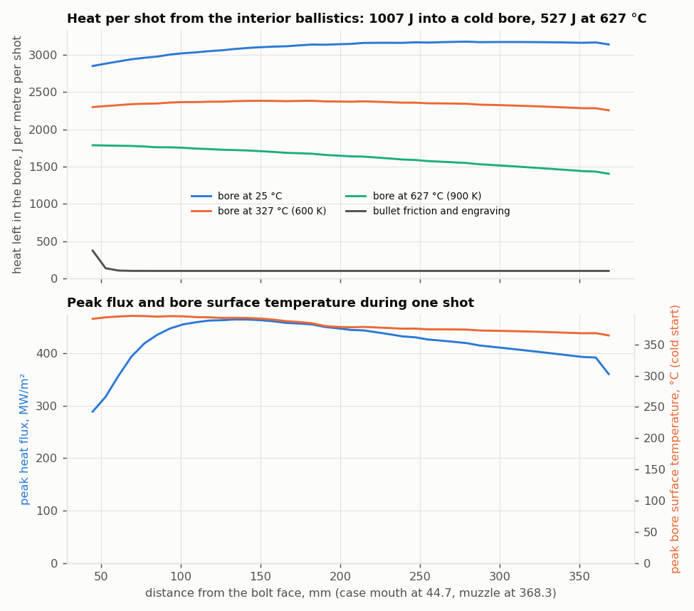
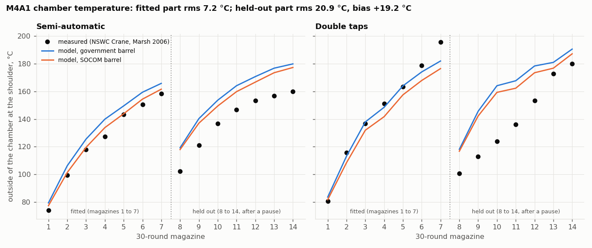
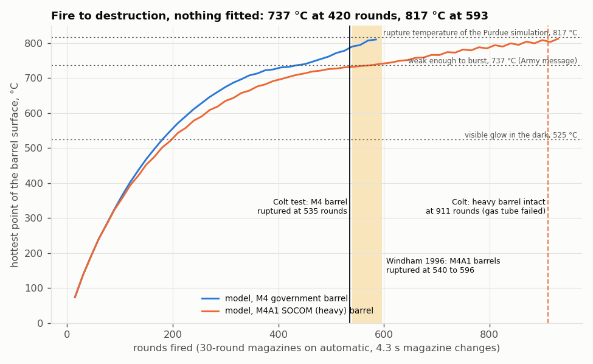
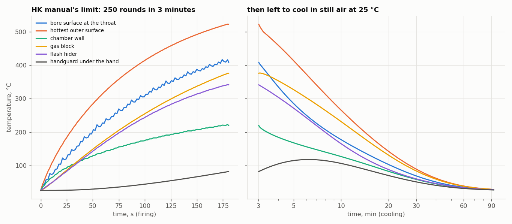
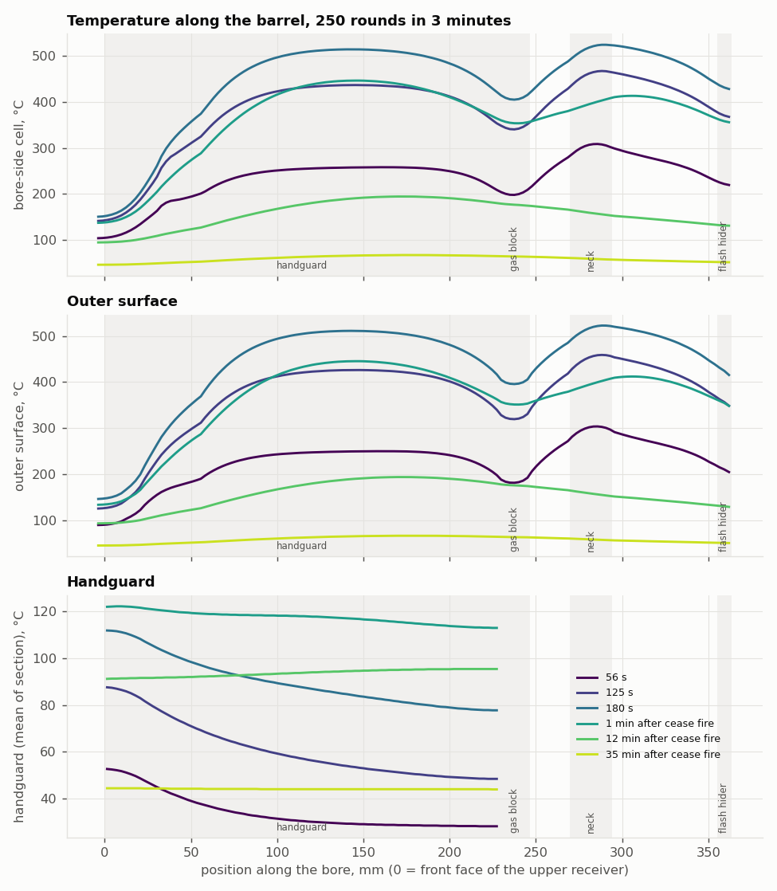
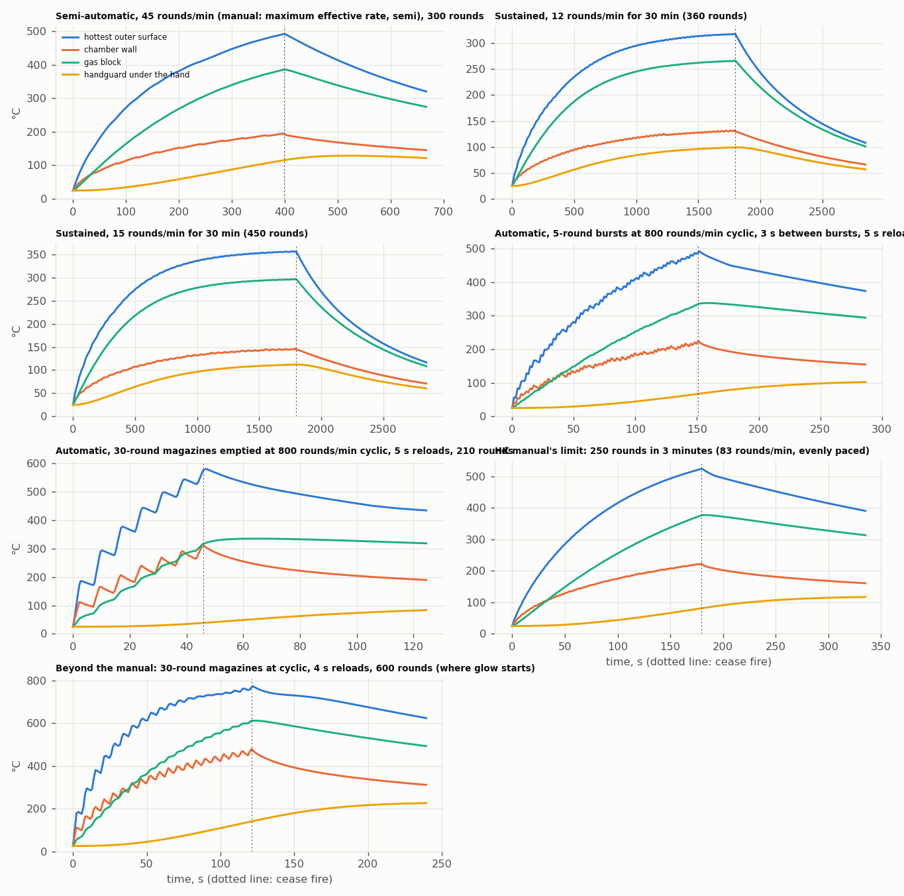
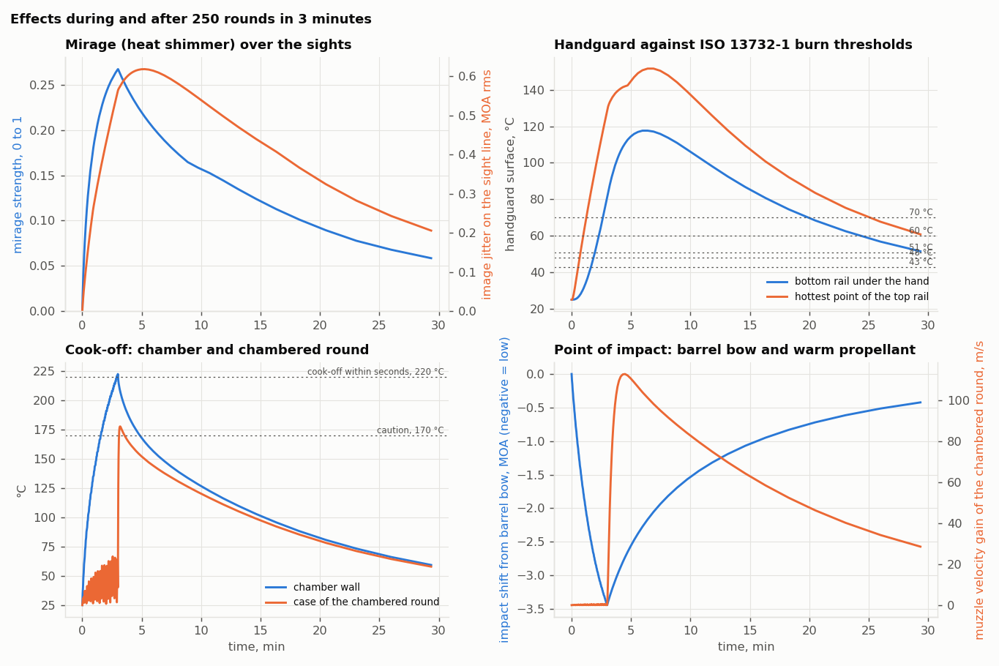
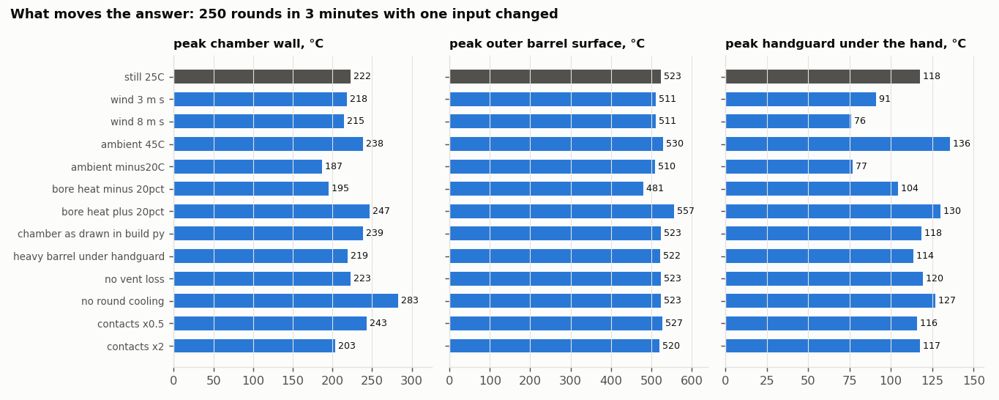

# HK416 D14.5RS: barrel and handguard heating

A thermal simulation of the HK416 (14.5 in barrel) under fire: how much heat each shot leaves in the bore, how it
spreads through the barrel, gas block, piston, flash hider, barrel nut, receiver and handguard, how it leaves by
convection and radiation, and what that means for a game: heat shimmer over the sights, whether the handguard can be
held, whether a chambered round can cook off, and how far the point of impact moves. It produces data and a runtime
module; it is not game code. Model and simulation credit: carpetshark.

Rebuild everything (about 5 to 15 minutes on a busy machine; Python 3 with numpy and matplotlib, then node):

```
python3 sim.py            # validation, seven firing schedules, heat.json, plots/
python3 sim.py --validate # only the checks against published M4A1 data
node test_heat.js         # checks hk416-heat.js against sim.py, writes parity.json
```

| File | What it is |
|---|---|
| `sim.py` | the simulation; every parameter is in its `PARAMS` table with a source |
| `plots.py` | the plots (called by `sim.py`; `python3 plots.py` redraws from `heat.json`) |
| `heat.json` | heat per shot, validation results, seven schedules (time series and temperature profiles), effect tables, sensitivity, and the `runtime` block the JS module runs on |
| `hk416-heat.js` | self-contained browser and Node module: the same model, stepped live |
| `test_heat.js` | Node checks of the module, including the parity test against `sim.py` |
| `parity.json` | the committed result of that parity test |
| `plots/` | eight plots |

## Conventions

- Frame: the asset's. Positions along the barrel are `z_mm`: millimetres along +Z (towards the muzzle), 0 at the upper
  receiver's front face. The barrel runs from its breech at -5 mm to the muzzle at 363.3 mm (`model/build.py`). Where a
  distance is "from the bolt face" it is measured from the breech end (z = -5 mm).
- Temperatures are degrees Celsius in every output and kelvin inside the solver. Time is seconds.
- "Bore" temperatures are the mean of the innermost cell of the wall (about 1.5 mm thick), not the bore surface's
  peak during a shot. The per-shot surface peak is in `shot_heat` (about 371 °C above a cold bore).
- The handguard "under the hand" is at `socket_hand_left` (z = 110 mm, bottom rail).

## The physics

1. **Heat per shot, from `action/`.** `action.json` gives the gas state of one shot: breech pressure, mean gas
   temperature, bullet travel and speed, sampled every 10 µs for 4 ms. From it, at 41 stations along the bore, the
   gas-side heat-transfer coefficient is the turbulent pipe-flow correlation of Dittus and Boelter,
   Nu = 0.023 Re^0.8 Pr^0.4, on the local gas speed of the Lagrange profile (linear from the breech to the bullet
   base, in the same equivalent-length coordinate `action/sim.py` uses for its port pressure; sonic at the muzzle
   during blowdown). Gas density is the gas mass over the volume behind the bullet; viscosity is Sutherland's law for
   air; the Prandtl number is Eucken's 4γ/(9γ-5) = 0.81. The blowdown is continued past the 4 ms record with the
   same isentropic choked outflow `action/sim.py` uses, to 1.05 atm (7.1 ms). The wall side is one-dimensional
   implicit conduction on a graded grid (2 µm at the surface) with temperature-dependent steel properties. The
   coefficient is used as published: **there is no fitted multiplier on it**.
   The heat a shot leaves falls as the bore gets hotter, almost exactly linearly (within 0.7 %), so the model
   stores two numbers per station: the heat into a 25 °C bore and the bore temperature at which it would be zero
   (1,380 to 1,900 K).
   To this are added half of the bullet's friction and engraving work (`p_friction`, `p_engrave` of `action.json`),
   15 J around the gas port, and 20 J to the flash hider (both inferred).
2. **Gas system.** The gas cylinder of `action/sim.py` keeps 75 % of the enthalpy that flows in (`cyl_heat_eff`); the
   other 25 % is wall heat. Recomputing its orifice inflow from `action.json` (port pressure, gas temperature,
   cylinder pressure, port diameter and discharge coefficient) gives 62 mg of gas and 46 J of wall heat per
   shot, split 78:22 between the gas block and the piston with its rod (the split is inferred).
3. **Chamber.** The case shields the chamber wall. Conduction through a 0.6 mm brass wall before the case is pulled
   (3.3 ms after ignition, from `action.json`) would pass only 0.14 of the first bore station's heat per unit length.
   Measured chamber temperatures need far more, so the chamber's heat per unit length is one **calibrated** factor,
   `f_chamber` = 1.85 times the first bore station (about 236 J per shot over the case length).
4. **The chambered round.** Its brass case is a 2.4 J/K lump on the chamber wall (1.0 W/K, inferred from 1,000 W/m²K
   over the case wall area of `action.json`). Every shot throws the fired case out with whatever heat it has taken
   and chambers a fresh round at ambient. In slow fire this is a real cooling path: the case takes 2.4 s to follow
   the wall, so each round carries off up to 2.4 J per kelvin of chamber excess. In automatic fire it is negligible.
   The same lump drives the cook-off and velocity outputs below.
5. **Barrel.** Axisymmetric finite volumes in (r, z): 146 stations of about 2.5 mm, cut at every step of the profile,
   by 4 radial cells. Explicit in time, in enthalpy form with the EN 1993-1-2 specific heat of steel (including the
   735 °C transformation peak) and a conductivity falling from 43 to 27 W/m/K. The profile is read from
   `../model/build.py` at run time (its ruler and `P` table are executed, nothing is copied by hand).
6. **Losses.** Free convection on horizontal cylinders by Churchill and Chu, forced convection in a cross-wind by
   Churchill and Bernstein, the two blended as cubes; air properties at the film temperature. Grey-body radiation
   with emissivity 0.85. Under the handguard the barrel loses heat to the handguard by radiation between
   concentric grey cylinders and by the Raithby-Hollands annulus convection; a quarter of the gap convection and
   5 % of the radiation leave through the vents (inferred).
7. **Handguard and lumps.** The handguard is a one-dimensional aluminium bar (0.40 kg, 6061) along z, heated by the
   barrel across the gap, by the piston rod, and by conduction from the barrel nut; it loses heat outside by the
   same convection and radiation laws. Its top runs 20 % of its excess hotter than the section mean and the bottom
   10 % cooler (inferred). The gas block, piston, flash hider crown, barrel nut and two halves of the upper receiver
   are lumps joined by inferred contact conductances.

## What is published and what is inferred

- **action**: taken from `../action/action.json` (which has its own sources: HK's manual for 850 m/s and 358.5 MPa).
- **build.py**: read from `../model/build.py` (photo-derived, so real to the accuracy of the model, not a drawing).
- **handbook**: material properties from standard references (ASM for 4140, EN 1993-1-2, 6061 and 7075 data sheets).
- **inferred**: an engineering estimate, stated as one. Nothing with this label was measured.
- **calibrated**: one number, `f_chamber`, fitted so the model reproduces published chamber temperatures.

| Parameter | Value | Unit | Source |
|---|---|---|---|
| `charge_mass_g` | 1.691 | g | action.json m_charge: M855, 26.1 gr WC844 (US Army TM 43-0001-27) |
| `propellant_energy_J_per_g` | 4167 | J/g | action.json: F / (gamma - 1), the energy the gas can give up (force 1.0 MJ/kg, gamma 1.24) |
| `bullet_mass_g` | 4.018 | g | action.json m_bullet: M855, 62 gr |
| `muzzle_velocity_m_s` | 850 | m/s | HK manual p. 7, 14.5 in barrel (action.json) |
| `bore_heat_scale` | 1 | - | multiplier on the Dittus-Boelter bore heat-transfer coefficient. 1.0 = the correlation as published, NOT fitted; the fire-to-destruction counts check it |
| `f_chamber` | 1.85 | - | CALIBRATED on the NSWC Crane M4A1 chamber temperatures (first firing sequence): heat per unit length into the chamber wall relative to the first bore station; see README |
| `g_chamber_case` | 1 | W/K | inferred: contact conductance between the chamber wall and the chambered round, 1000 W/m2/K over the 1100 mm2 case wall of action.json. The Crane data support it weakly: see validation.fit_scan |
| `c_case_J_K` | 2.356 | J/K | heat capacity of the brass case: action.json m_case 6.2 g x 380 J/kg/K (C26000 handbook) |
| `case_wall_m` | 0.0006 | m | inferred: mean 5.56 mm case wall over the body and shoulder (0.3 mm at the neck to about 1 mm near the head) |
| `chamber_h_ratio` | 0.57 | - | inferred: gas-side heat-transfer coefficient inside the case relative to the first bore station (half the gas speed, to the power 0.8) |
| `k_brass` | 120 | W/m/K | cartridge brass C26000, handbook |
| `rhoc_brass` | 3.241e+06 | J/m3/K | cartridge brass C26000, handbook |
| `friction_to_bore` | 0.5 | - | inferred: share of the bullet friction and engraving work (action.json p_friction, p_engrave) that stays in the bore; the rest leaves in the jacket |
| `q_port_J` | 15 | J/shot | inferred: extra bore heating around the gas port (Purdue thesis: port heating "should not be neglected") |
| `piston_share` | 0.22 | - | inferred: share of the gas-cylinder wall heat taken by the piston and rod, the rest by the gas block |
| `q_gas_block_di_J` | 10 | J/shot | inferred, validation rifles only: a direct-impingement gas block keeps little heat (the gas goes down the tube) |
| `q_flash_hider_J` | 20 | J/shot | inferred: muzzle gas washing the birdcage; large uncertainty |
| `case_len_m` | 0.0447 | m | 5.56x45 case length 44.70 mm (action.json) |
| `rho_steel` | 7850 | kg/m3 | Cr-Mo-V barrel steel (4140/4150 class), handbook |
| `eps_steel` | 0.85 | - | manganese-phosphated / black-oxide steel, handbook 0.8 to 0.9 |
| `alpha_steel` | 1.23e-05 | 1/K | 4140 mean expansion 20 to 300 C, handbook |
| `rho_al` | 2700 | kg/m3 | 6061-T6 handbook (7075: 2810) |
| `k_al_hg` | 167 | W/m/K | 6061-T6 handbook |
| `k_al_upper` | 130 | W/m/K | 7075-T6 handbook |
| `eps_al` | 0.85 | - | black hard-anodised aluminium, handbook 0.8 to 0.9 |
| `hg_area_m2` | 0.00065 | m2 | metal cross-section: 0.20 m perimeter x 3 mm wall + four rails, less vents -> 0.40 kg (inferred from the build.py section) |
| `hg_perim_out_m` | 0.26 | m | convecting perimeter: 0.20 m envelope x 1.3 for rail lugs (inferred) |
| `hg_perim_rad_m` | 0.2 | m | radiating envelope perimeter (build.py) |
| `hg_r_inner_m` | 0.0234 | m | inner half-width 26.4 - 3.0 mm (build.py) |
| `hg_view_to_ambient` | 0.05 | - | fraction of barrel radiation leaving through vents and the open front (vent area / wall area, build.py) |
| `hg_vent_fraction` | 0.25 | - | inferred: share of the gap convection carried straight out of the vents and front |
| `hg_top_bottom_split` | 0.2 | - | inferred: top of the handguard runs this fraction of its excess hotter than the mean, the bottom half that cooler |
| `g_barrel_nut` | 4 | W/K | inferred: barrel flange clamped by the nut at 110 N m, 200 mm2 at 20 kW/m2/K |
| `g_nut_handguard` | 3 | W/K | inferred: sliding fit of the rail on the barrel nut, 2000 mm2 at 1.5 kW/m2/K |
| `g_nut_upper` | 2 | W/K | inferred: nut threads on the 7075 receiver ring |
| `g_barrel_upper` | 1.2 | W/K | inferred: barrel extension, slip fit in the receiver bore |
| `m_nut` | 0.061 | kg | build.py barrel_nut: 29 mm OD, 19.8 mm ID, 22 mm long |
| `g_upper_front_rear` | 0.65 | W/K | inferred: 450 mm2 of receiver wall over 90 mm |
| `g_handguard_upper` | 1 | W/K | inferred: handguard rear face against the receiver |
| `g_barrel_gas_block` | 5 | W/K | inferred: pinned gas block journal, 1050 mm2 at 5 kW/m2/K |
| `g_gas_block_piston` | 0.4 | W/K | inferred: piston with three rings in the cylinder cup |
| `g_barrel_fh` | 0.37 | W/K | steel 160 mm2 over 15 mm between the threads and the birdcage (build.py) |
| `m_gas_block` | 0.1 | kg | build.py gas block prism 72 g + front sight base 30 g (volume x 7850) |
| `m_piston` | 0.075 | kg | inferred: piston, rod and guide |
| `m_fh_front` | 0.031 | kg | build.py birdcage ahead of the muzzle, slots removed |
| `m_upper_front` | 0.1 | kg | inferred: front 50 mm of the upper receiver |
| `m_upper_rear` | 0.3 | kg | inferred: rest of the upper receiver |
| `a_gas_block` | 0.0035 | m2 | build.py gas block outer area |
| `a_piston` | 0.0065 | m2 | build.py gas_piston_tube: 9.8 mm x 210 mm |
| `a_fh_front` | 0.004 | m2 | build.py birdcage, inside + outside |
| `a_upper_front` | 0.012 | m2 | inferred |
| `a_upper_rear` | 0.035 | m2 | inferred |
| `ambient_C` | 25 | C | default |
| `wind_m_s` | 0 | m/s | default: still air |
| `cyclic_rpm` | 800.9 | rounds/min | action.json auto.rpm, the simulated cyclic rate (HK manual p. 7: 700 to 900) |
| `k_steel` | 42.7 - 0.0165*T_C, floor 27 | W/m/K | linear fit to ASM handbook 4140 (42.7 at 100 C, 33 at 600 C) |
| `c_steel` | EN 1993-1-2 curve | J/kg/K | Eurocode 3 part 1-2 specific heat of carbon steel, incl. the 735 C transformation peak; 440 at 20 C |
| `c_al` | 896 + 0.45*(T_C - 25) | J/kg/K | handbook 6061 (896 at 25 C, about 1020 at 300 C) |

Steel conductivity 42.7 - 0.0165 T (°C), floor 27 W/m/K (linear fit to ASM handbook 4140). Steel specific heat: the
EN 1993-1-2 curve. Aluminium specific heat 896 + 0.45 (T - 25) J/kg/K. Bore radii: chamber 4.7 mm, case neck 3.2 mm,
grooves 2.82 mm (CIP 5.56×45).

One correction to the model's shape matters here. `build.py` draws the barrel's chamber end, which is hidden inside
the receiver, nut and handguard, as a plain 20 mm cylinder. That would leave 5.3 mm of steel around the chamber. This
simulation uses the AR-pattern chamber reinforce instead: 24.9 mm diameter to z = 57 mm, and a 25.4 mm barrel
extension behind z = 11 mm (both inferred). Everything a photo shows follows `build.py`. The sensitivity table shows
what the choice does.

## Heat per shot



| Where | Heat per shot, cold gun |
|---|---|
| Bore ahead of the case mouth, gas to wall | 1007 J (759 J with the bore at 327 °C, 527 J at 627 °C) |
| of which while the bullet is in the bore | 346 J |
| Friction and engraving left in the bore | 34 J |
| Chamber (calibrated) | 236 J |
| Gas block / piston and rod | 36 J / 10 J |
| Gas port / flash hider (inferred) | 15 J / 20 J |
| **Total** | **1,355 J, 19 % of the 7,047 J the charge can give up** (bullet energy: 1,451 J) |

A cross-check inside the asset: `action.json` assumes the gas loses heat to the bore, while the bullet is in it, at
`loss_factor` = 0.2 times the work done on bullet and gas, which is 345 J. The correlation here gives 346 J
for the same interval. The correlation does not use `loss_factor`; it sees only the gas state that results. Most of
the bore heat arrives later, during blowdown.

## Checks against published measurements

### 1. M4A1 chamber temperatures, NSWC Crane

C. Marsh, *Small Arms Propellant Thermal Stability*, NSWC Crane, NDIA Small Arms Symposium 2006 (slides 4 to 6).
M4A1 carbines with a thermocouple outside the chamber at the shoulder fired seven 30-round magazines of MK 262, were
reloaded, and fired seven more. The slides give the temperature at the end of each magazine and the seconds each
took. The model fires the same sequences through an M4A1 barrel (approximate drawing values for the government and
the SOCOM profile, since the slides do not say which) and reads its outer surface 36.5 mm from the bolt face.
`f_chamber` was fitted to magazines 1 to 7 of the semi-automatic and the double-tap weapon. Magazines 8 to 14 were
not used in the fit.



| | rms error | mean error |
|---|---|---|
| Magazines 1 to 7 (fitted), 14 points × 2 barrel profiles | 7.2 °C | +0.0 °C |
| Magazines 8 to 14 (held out), 14 points × 2 barrel profiles | 20.9 °C | +19.2 °C |

Measured temperatures run from 74 to 196 °C. The held-out part is too hot by about 20 °C: after the pause the real gun
warmed more slowly than the model, which points to a heat sink at the chamber end that the model lacks (the bolt
group, the receiver's full mass). Chamber temperatures in long schedules therefore err on the hot side.
Not in the slides and assumed here: 20 s for each magazine change, and three missing magazine durations (taken as the
weapon's mean). Without the cooling by chambered rounds the fit is nearly as good on magazines 1 to 7
(`f_chamber` 1.15, rms 9.1 °C) but worse on the held-out part (rms 26.8 °C, mean +25.5 °C);
`validation.fit_scan` in `heat.json` has the numbers. The third weapon (3 to 5 round bursts) is not used: its
record has a temperature drop and missing durations.

### 2. Fire to destruction (nothing fitted)

M4-pattern barrels fired on automatic until they fail are the hardest published test of the bore heat. The model
fires 30-round magazines at 850 rounds/min with 4.3 s magazine changes (535 rounds in 111 s).



| | Published | Model |
|---|---|---|
| M4, government barrel | ruptured at 535 rounds (Colt test, New York Times *At War* blog, 12 Jan 2010); M4A1 barrels at 540 to 596 rounds (Windham 1996, DTIC ADA317929) | hottest outer surface passes 737 °C at 420 rounds and 817 °C at 593 rounds |
| M4A1, heavy barrel | 911 rounds, barrel intact, gas tube failed (same Colt test); about 930 rounds to burst (The Firearm Blog, *The M4A1 Carbine Evolution*) | 737 °C at 570 rounds, 809 °C at 911 rounds, 817 °C at 930 rounds |
| Hottest place, government barrel | 92 mm from the breech in a Purdue simulation (thesis AAI30501545, per the earlier build's notes) | 120 mm from the bolt face |

737 °C is the temperature an Army message of 1996 gives as weak enough to burst; 817 °C (1,090 K) is the rupture
temperature of the Purdue simulation. The published figures in this table come from secondary accounts: the DTIC
report could not be re-read for this build (the server refused the download), and the Colt video's time of
1 min 51 s is from the earlier build's notes (the accounts found say "about two minutes").

### 3. Rounds to the cook-off point

US Army TM 9-1005-319-10 warns that 140 rounds fired rapidly and continuously bring an M16A2 barrel to the cook-off
point (150 for the M4 and 180 for the M4A1 in later editions, per the earlier build's notes). The TM gives neither
the rate nor a temperature. Taking 90 rounds/min and a 180 °C chamber wall (both inferred), the model needs
155 rounds for the government M4 barrel, 165 for the SOCOM barrel and 139 for this HK416. This is a
plausibility check, not a validation.

### 4. Energy, grid and parity

- Energy: deposited heat minus losses minus stored heat closes to within 0.6 J in every schedule (of up to
  532 kJ deposited).
- Grid: `hk416-heat.js` runs 5 mm stations with 3 radial cells at a 0.049 s step; the full model runs 2.5 mm
  stations with 4 radial cells. On the manual's schedule the two agree within 1.9 °C on every probe except the
  bore-side cell at the throat (12 °C, a spiky quantity that depends on when after a shot it is sampled).
  That is both the accuracy of the runtime and the grid check of the full model
  (`runtime.accuracy_vs_full_grid` in `heat.json`).
- **JS against Python**: `test_heat.js` replays two cases (250 rounds in 3 minutes at 25 °C in still air; four
  magazines on automatic at 40 °C in a 3 m/s wind) with the same grid, step and shot times, and compares every
  probe, every effect and the final temperature fields: largest difference 2×10⁻¹⁰ K
  (`parity.json`). One model step takes about 3 µs in Node.

## Results

Still air, 25 °C. All temperatures are peaks in °C.

| Schedule | Rounds | Firing time | Chamber wall | Bore cell at the throat | Hottest outer surface | Gas block | Handguard under the hand | Hand passes 48 °C at round | Chamber passes 170 / 220 °C at round | Bow, MOA | Mirage strength |
|---|---|---|---|---|---|---|---|---|---|---|---|
| Semi-automatic, 45 rounds/min | 300 | 399 s | 195 | 366 | 492 | 386 | 129 | 122 | 204 / - | -3.2 | 0.25 |
| Sustained, 12 rounds/min for 30 min | 360 | 1795 s | 132 | 219 | 318 | 266 | 99 | 81 | - / - | -1.9 | 0.19 |
| Sustained, 15 rounds/min for 30 min | 450 | 1796 s | 147 | 250 | 357 | 297 | 112 | 83 | - / - | -2.2 | 0.20 |
| Automatic, 5-round bursts at 800 rounds/min cyclic, 3 s between bursts, 5 s reloads, 210 rounds | 210 | 151 s | 224 | 401 | 491 | 337 | 105 | 150 | 115 / 205 | -3.2 | 0.26 |
| Automatic, 30-round magazines emptied at 800 rounds/min cyclic, 5 s reloads, 210 rounds | 210 | 46 s | 312 | 479 | 581 | 335 | 105 | 210 | 75 / 109 | -3.5 | 0.27 |
| HK manual's limit: 250 rounds in 3 minutes | 250 | 180 s | 222 | 417 | 523 | 377 | 118 | 155 | 131 / 243 | -3.4 | 0.27 |
| Beyond the manual: 30-round magazines at cyclic, 4 s reloads, 600 rounds | 600 | 121 s | 479 | 743 | 771 | 611 | 226 | 270 | 82 / 107 | -5.4 | 0.33 |





The manual (p. 4) says to let the rifle cool after 250 rounds of rapid fire in under 3 minutes. In the model that
schedule ends with the hottest part of the barrel at 523 °C, which is the threshold of visible glow in
the dark (525 °C), and the chamber wall at 222 °C, which passes the cook-off danger line (220 °C) at round
243. Neither threshold was tuned to the manual. The manual's sustained rate of 12 to 15 rounds/min keeps the
chamber at 132 to 147 °C after 30 minutes, below the 170 °C caution line.
After the 250 rounds the chamber is back under 170 °C 118 s after cease fire, the barrel is under 150 °C
after 18 min and under 60 °C after 40 min, and the handguard under the hand peaks 3 min after
the last shot (the heat arrives late) and can be held bare-handed again (48 °C) after 30 min.

## Effects for a game



**Mirage (heat shimmer).** Two line plumes rise from the gun: one from the exposed barrel, one from the top of the
handguard (including the gap air that leaves through the vents). Each is the turbulent line plume of Rouse, Yih and
Humphreys (1952): buoyancy flux F = g Q / (ρ c_p T), centre-line excess temperature 2.6 F^(2/3) T / (g y), rise
speed 1.8 F^(1/3), half-width 0.156 y; in a cross-wind faster than the rise speed the plume bends over and is carried
off the sight line. The refractive index follows n - 1 = 0.0796 / T (Edlén, visible light, sea level). Outputs:
`strength` (the index drop 30 mm above the hotter source as a fraction of the air's whole refractivity, which is
ΔT / (T + ΔT): 0 to 1), plume `heightM` (where the excess falls to 3 K), `riseMps`, `jitterMoa` (rms image wander on
the sight line, 65.5 mm above the bore) and `steadyMoa` (the steady upward shift of the image). A renderer scales its
distortion by `strength`, scrolls it at `riseMps` and fades it at `heightM`. The jitter and steady-shift formulas are
order-of-magnitude estimates; nothing here was checked against a measured mirage.

**Handguard comfort.** The surface temperature under the hand is classed against the burn thresholds of
**ISO 13732-1:2006** for bare skin on uncoated metal: 43 °C (8 h and longer), 48 °C (10 min), 51 °C (1 min), about
55 °C (10 s), 65 to 70 °C (1 s); MIL-STD-1472 gives 49 °C for prolonged and 60 °C for momentary contact with metal.
Levels: 0 comfortable (< 43), 1 warm (< 48), 2 hot (< 51), 3 burn within a minute (< 60), 4 burn on grip (< 70),
5 burn on touch. `contactC` is the skin-metal interface temperature of two half-spaces (skin at 33 °C, effusivity
1,300; both inferred), about 95 % of the way to the metal's temperature for aluminium. Gloves and polymer rail covers
are not modelled.

**Cook-off.** The case of the chambered round follows the chamber wall (item 4 above). The propellant against the
case wall fires after an induction time t = t₁ exp(E/R (1/T - 1/T₁)), accumulated as a damage integral that resets
at every shot. Two anchors fix it, both inferred readings of published statements: 600 s at 170 °C (smokeless
propellant self-ignites at 160 to 200 °C on slow heating) and 10 s at 220 °C (the TM's warning that a round left in a
barrel at the cook-off point may fire in as little as 10 seconds). Check: Marsh (slide 8) soaked rounds in a 166 °C
chamber for up to 60 s and fired them without reporting a cook-off; the model gives 874 s at 166 °C. A fresh
round left in a chamber held at 200 °C fires after 54 s, at 220 °C after 18 s, at 300 °C after 5 s.
`risk` is "caution" from a 170 °C chamber wall and "danger" from 220 °C or when the damage integral passes one half.
The model always has a round chambered; a rifle that locks open on an empty magazine has none.

**Point of impact.** Three effects, reported separately:
- *Barrel bow* (`bowMoa`, negative = low). A beam with a temperature difference ΔT across its depth D curves by
  α ΔT / D (Timoshenko's thermal bending of beams). A hot horizontal barrel is hotter on top (it sits in its own
  plume, and the gas block and piston are above it); the top-to-bottom difference is taken as 1 % of the local excess
  temperature, which is a **guess**. Integrated over the free barrel ahead of the nut this gives 0.8 MOA low after
  one 30-round magazine on automatic and 3.4 MOA low at the end of the manual's schedule. Range reports of
  0.5 to 2 MOA after a magazine dump (RECOIL magazine's barrel-profile test, as noted by the earlier build; not
  re-read) are the only support for the size. Real barrels also walk from residual stress, in directions no model
  can predict.
- *Warm propellant* (`mvDelta`, m/s). The propellant follows the case with a 25 s lag (inferred). Marsh's slide 8
  gives 65,172 psi after 15 s in a 200 °F chamber and 85,662 psi after 60 s at 330 °F for one lot; with velocity
  going as pressure^0.4 (inferred) that is 0.85 m/s per kelvin, capped at the 166 °C of the source data. Rounds
  fired in a rhythm gain 1 to 16 m/s; a round left for a minute in a hot chamber gains up to 120 m/s, and its
  pressure rises by a third. Pass `850 + mvDelta` to `HK416Ballistics.fire({ muzzleVelocity })` for the change of
  drop at any range.
- *Mirage shift* (`mirageShiftMoa`). The image moves, not the bullet; see above.

**Glow.** Grey-body luminance (Planck × CIE 1931 ȳ) and colour of the hottest surface, zero below 400 °C; the
classical threshold of visible incandescence in the dark is 525 °C (the Draper point).

## What moves the answer

250 rounds in 3 minutes, one input changed at a time (peaks, °C):

| Case | Chamber wall | Hottest outer surface | Handguard under the hand | Barrel steel, kg |
|---|---|---|---|---|
| still 25C | 222 | 523 | 118 | 0.779 |
| wind 3 m s | 218 | 511 | 91 | 0.779 |
| wind 8 m s | 215 | 511 | 76 | 0.779 |
| ambient 45C | 238 | 530 | 136 | 0.779 |
| ambient minus20C | 187 | 510 | 77 | 0.779 |
| bore heat minus 20pct | 195 | 481 | 104 | 0.779 |
| bore heat plus 20pct | 247 | 557 | 130 | 0.779 |
| chamber as drawn in build py | 239 | 523 | 118 | 0.718 |
| heavy barrel under handguard | 219 | 522 | 114 | 0.853 |
| no vent loss | 223 | 523 | 120 | 0.779 |
| no round cooling | 283 | 523 | 127 | 0.779 |
| contacts x0.5 | 243 | 527 | 116 | 0.779 |
| contacts x2 | 203 | 520 | 117 | 0.779 |



## Runtime module

```js
await HK416Heat.load('heat.json');                       // or HK416Heat.use(json)
const gun = HK416Heat.create({ ambientC: 25, wind: 0 }); // wind: m/s across the barrel
gun.fire();              // once per shot
gun.advance(dt);         // every frame; steps the model at its own fixed step
const s = gun.state();   // see the header of hk416-heat.js for every field
gun.profile();           // { zMm, outerC, boreC, handguardZMm, handguardC }
gun.outerAt(zMm);        // outer barrel temperature at a position, for a material or a glow map
gun.setEnvironment({ ambientC, wind });
HK416Heat.simulate(shotTimes, tEnd, sampleTimes, { ambientC, wind });   // offline run, same stepping as sim.py
HK416Heat.schedule('manual_250_in_3min');                // the precomputed full-grid run from heat.json
HK416Heat.cookoffTime(chamberC); HK416Heat.comfort(surfaceC); HK416Heat.glow(tempC);
```

`gun.state({ cookoffTime: false })` skips the one costly field (a short integration) when it is called every frame.

## Limits

- **Nothing here was measured on an HK416.** The checks are against M4A1 data; the HK416's handguard, gas block and
  piston temperatures have no published measurement behind them. The handguard figures in particular rest on
  inferred contact conductances and an inferred gap model.
- The heat per shot uses a pipe-flow correlation on a lumped interior ballistics model. It is unfitted and passes the
  destruction check, but its split between the in-bore phase and blowdown, and its nearly flat distribution along
  the bore, are not validated. Erosion models that need the bore surface's peak temperature should not use it.
- The chamber is the weakest part: its heat is a calibrated factor, the held-out Crane data run 20 °C cooler than
  the model, and the chamber reinforce is an inferred shape. Cook-off outputs inherit all of that, plus two
  inferred anchors. They rank schedules sensibly; they are not a safety calculation.
- One load only (M855 through `action.json`). The Crane data are MK 262; the difference is ignored.
- The barrel is axisymmetric: no top-to-bottom gradient is solved (the bow uses a guessed 1 % asymmetry), and no
  flutes, gas port hole, sling or bayonet lug.
- Still air or a steady cross-wind only; no rain, no sun load, no shooter's hand or glove on the handguard, no
  suppressor. The rifle is horizontal.
- The bolt carrier group, lower receiver, magazine and optic are not in the model; heat that would soak into them
  stays in the barrel end.
- Mirage is a pair of ideal line plumes; its image-shift numbers are estimates.
- Above about 800 °C the model keeps going but a real barrel has failed; nothing models the failure.
- The profile under the handguard is what shows through the vents in one photo (18.6 mm). The barrel steel comes
  to 0.78 kg and the handguard to 0.40 kg.

## Sources

- Heckler & Koch USA, *Maintenance Manual for HK416 Enhanced Carbine & Rifle System*: p. 4 (250 rounds in 3 minutes),
  p. 7 (rates of fire, velocity, pressure). Summarised in `../notes/MANUAL_NOTES.md`.
- `../action/` (interior ballistics, gas system, case, events) and `../model/build.py` (barrel and handguard shape).
- C. Marsh, *Small Arms Propellant Thermal Stability*, NSWC Crane, NDIA Small Arms Symposium 2006: chamber
  temperatures (slide 6), chamber pressures of heat-soaked rounds (slide 8), 400 °F chambers in extreme use (slide 2).
  Read for this build.
- J. Windham, *Fire to Destruction Test of 5.56mm M4A1 Carbine and M16A2 Rifle Barrels*, AMSTA-AR-ES-96-2, 1996
  (DTIC ADA317929), and *External Barrel and Handguard Temperature of the 5.56mm M4 Carbine*, SMCAR-ES-94-1, 1994
  (DTIC ADA285699). Neither could be re-read for this build; figures are from secondary accounts. The 1994 report is
  the obvious next check for the handguard.
- New York Times *At War* blog, 12 January 2010 (Colt's M4 and M4A1 tests), as summarised by AccurateShooter's
  Daily Bulletin; The Firearm Blog, *The M4A1 Carbine Evolution*.
- US Army TM 9-1005-319-10 (M16A2, M4, M4A1 operator's manual): cook-off warnings.
- F. W. Dittus and L. M. K. Boelter (1930); S. W. Churchill and H. H. S. Chu (1975); S. W. Churchill and
  M. Bernstein (1977); G. D. Raithby and K. G. T. Hollands (1975); H. Rouse, C. S. Yih and H. W. Humphreys (1952).
- EN 1993-1-2 (specific heat of steel); ASM Handbook (4140, 6061, 7075, C26000).
- ISO 13732-1:2006 and MIL-STD-1472 (contact temperature limits).
- C. Wyman, P.-P. Sloan and P. Shirley (2013), analytic fits to the CIE colour matching functions.

## History

2026-11-17: first version in openFPS (Claude Fable 5.2). It replaces an unfinished private build whose bore heat was
one fitted number with a fitted shape; here the bore heat comes from `action/` unfitted, the barrel shape is read from
`model/build.py`, the chambered round is modelled, and the JS module is a line-for-line port with a parity test.
