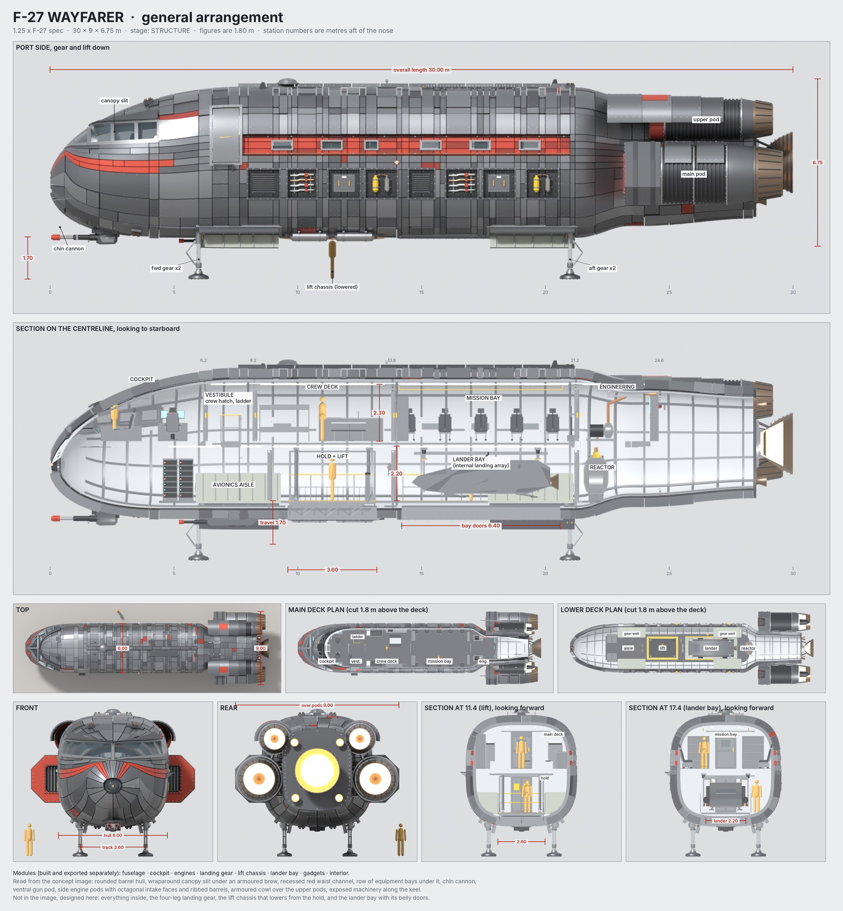

# F-27 Wayfarer: how to use this asset

A boardable 30 m gunship (30.0 x 9.0 x 6.75 m) for first-person play, built by code down to the bolt. The player can
walk up to it on its landing gear, ride the lift chassis into the hold, walk two decks, sit in the cockpit and drop
from the lander bay. Credit: carpetshark.

**Sample artifact:** [`sample/index.html`](sample/index.html) is a viewer for a build you make yourself: orbit, jump
to places inside, hide modules, slide a cutaway through the hull and run every mechanism.



## Status

This is the **structure stage**: the whole ship exists at true size with real walls, decks, doors and mechanisms, in
its detail pass. Every section has now had one: cockpit, engine section, landing gear, lift chassis, lander bay and the crew spaces. The outer hull has had one too, and a first wear layer is on. It is not finished art.

| Part | State |
|---|---|
| Geometry (`model/`) | A recipe in Blender Python. 158 named objects in eight modules, 1,514 armour plates, 525,000 triangles of which 208,000 are fasteners. It writes `out/wayfarer.glb`, a build output that is never committed. |
| Mechanisms | 11 keyed clips: landing gear, lift chassis with its ramp, lander bay doors and cradle, crew hatch, seven sliding doors. Kinematic only: the linkages are solved by geometry, not by forces. |
| Sockets | 14 named points for the game: eyes, thresholds, muzzles, exhausts, ground. |
| Checks (`model/tools/checks.py`) | 30 checks pass: the envelope, standing headroom on both decks, door and hatch sizes, the lift and lander fitting their openings, clip lengths. |
| Materials | Flat colours by role (30 named materials), times a wear layer: one colour attribute per mesh (`wear`, glTF `COLOR_0`) computed by rule in `model/wear.py` from where each vertex is: tone variation, plate-to-plate tint, belly grime, streaks, soot towards the nozzles, scuffing above the decks. Build with `--no-wear` to leave it off. No textures: scratches, chipped paint and fine streaks are not there, because a plate only has vertices at its corners. Markings are geometry (the hull number, placards). |
| Lander | A stub of the right size (5.6 x 2.2 x 1.7 m) hanging in the cradle. A real lander is a later asset. |
| Simulation | **None yet.** No mass, thrust, flight, gear loads or sound. This is the main gap against the repository's simulation-grade rule and is the next layer after detail. |
| Collision | Not made yet. The decks, bulkheads and lining are separate named objects, so a collision set can be cut from the recipe. |

## Build it

Needs a Python that `bpy` (Blender as a module) installs on, and `numpy`. Built here with bpy 5.3. A build takes a few seconds.

```
pip install bpy numpy
cd assets/wayfarer/model
python3 build.py --glb             # work/wayfarer.blend, out/wayfarer.glb (25 MB, every bolt)
python3 build.py --glb --lod 1 --tag wayfarer_lod1   # out/wayfarer_lod1.glb (14 MB, no fasteners)
python3 build.py --only engines    # one module, for working on it
python3 tools/checks.py            # sizes, clearances and clips
python3 blockout.py                # the stage-3 blockout
```

Then serve the repository and open the sample:

```
cd openFPS && python3 -m http.server 8790
# open http://127.0.0.1:8790/assets/wayfarer/sample/
```

Renders and the sheet:

```
python3 tools/render.py --blend work/wayfarer.blend --out work/final --shots three_quarter,cockpit --px 1600 --samples 48
python3 tools/render.py --blend work/wayfarer.blend --out work/ortho --shots ortho
python3 tools/sheet.py --in work/ortho --out ../renders/sheet_structure.jpg --stage STRUCTURE
```

## Frames and units

Metres. The recipe works in a ship frame and converts once on export.

| Frame | Forward | Right (starboard) | Up | Origin |
|---|---|---|---|---|
| Ship (in the code) | -s (s is metres aft of the nose, 0 to 30) | +y | +z | nose tip station, on the barrel axis |
| Blender | -Y | -X | +Z | middle of the ship (s = 15), on the barrel axis |
| glTF (`.glb`) | +Z | -X | +Y | same |

So a ship point (s, y, z) is glTF (-y, z, 15 - s). The main deck is at z = +0.10, the lower deck at z = -2.30 and the
ground, with the gear down, at z = -4.70.

## Modules

Each module is one file in `model/modules/` and one node under the root `wayfarer`. Hide or swap a module by its node.

| Node | What is in it |
|---|---|
| `fuselage` | Armour plates, substructure shell, lining, ring frames and longerons, both decks, seven bulkheads, ceilings and light strips, opening coamings. |
| `cockpit` | Canopy glazing and frame, instrument panel with displays and standby gauges, mode panel, pedestal with keypads and throttle quadrant, side consoles, pedals, overhead panel, two flight seats, two rear stations. The side sticks (`stick_pilot`, `stick_copilot`) and throttles (`throttle_port`, `throttle_stbd`) are their own nodes, pivoted where they turn, for the game to drive. |
| `engines` | Two main pods (octagonal intake, vanes, ribbed barrel, conduits, fuel manifold, accessory gearbox, nozzle with outer flaps and unison ring), two upper pods with cowls, the centre nozzle and thrust plate, pylons, struts and plumbing. `engine_fan_port` and `engine_fan_stbd` (compressor faces) and `engine_core_bell` (pivoted at its gimbal) are their own nodes for the game to spin and steer. |
| `landing_gear` | Four legs, each `gear_<pos>_leg` > `_piston` > `_pad`, with torque links, a landing light, an uplock roller, an actuator and two doors, in four wells fitted with an uplock jaw, accumulator, valve block and hydraulic lines. |
| `lift_chassis` | `lift_cage` (belly plate, truss, deck, posts, rails, toe boards, control pedestal, work lights, beacons, tie-downs), `lift_ramp`, `lift_ramp_sill`, ramp-end gates `lift_gate_port` and `lift_gate_stbd`, hold-end gates `lift_gate_aft_port` and `lift_gate_aft_stbd`, four telescopic rams, and the fixed guide rails, ram valves and pipework in the hold. |
| `lander_bay` | Two belly doors, `lander_cradle` (bracing, sway pads, clamp rams) on four jack screws with their drive motors and cross shaft, `lander_stub`, guard rails, and the catwalk fittings: control pedestal, hose reel, service panel, tool board, trestles, extinguishers. |
| `gadgets` | Nose sensors, chin turret (`chin_turret_ring` > `chin_turret_yaw` > `chin_gun_cradle`), ventral gun pod, keel tanks, dorsal arrays, equipment bay fits, thrusters, nav lights, and `hull_details`: seam straps, access panels with latches, a rung ladder each side, lifting lugs, louvred vents, walkway rails and pads, formation and flood lights, belly drain masts, a ground power receptacle and the hull number. |
| `interior` | Viewport glazing, crew hatch, sliding doors, ladder, bunks, lockers, galley, jump seats, racks, reactor, pump skids, switchboard, avionics racks, and one `<room>_details` object per room (`vestibule`, `crew_deck`, `mission_bay`, `engineering`, `lower_deck`) holding the fittings: bedding, galley, stowage, first aid, gauge board, breaker cabinet, workbench, battery boxes, cable trays, intercoms, extinguishers. |

Objects ending in `_bolts` hold the fasteners, one per module, so they can be hidden or dropped at distance.

## Clips

24 frames a second. The rest pose is parked on the ground: gear down, lift stowed, bay closed, doors shut.

| Clip | Frames | What moves |
|---|---|---|
| `gear_retract` | 84 | Legs fold into their wells (front pair aft, rear pair forward), pistons extend to clear, doors close. Play it backwards to lower the gear. |
| `lift_lower` | 138 | The cage descends 1.70 m on four rams until its belly plate is on the ground. A sill flap drops, the ramp slides forward out of its drawer, rises into the flap's slot until it is flush with the deck, and tilts down to the ground. The two gate bars swing forward to become its handrails. |
| `lander_bay_open` | 132 | The belly doors swing 100 degrees, then the cradle lowers the lander 1.45 m, clear of the belly. |
| `crew_hatch_open` | 54 | The port side hatch swings out and its step drops. |
| `door_<bulkhead>_<deck>_open` | 24 | Seven sliding doors. Main deck doors are one leaf; lower deck doors part in the middle. |

Each clip is one animation in the `.glb` that drives several nodes. In three.js, make one action per clip and scrub
its `time`; `sample/viewer.js` shows how.

## Sockets

Empty nodes named `socket_*`, parented to the part they ride on, so they follow the clips.

| Socket | Use |
|---|---|
| `socket_pilot_eye`, `socket_copilot_eye` | Seated camera positions. |
| `socket_crew_hatch_threshold` | Where the player steps in at the side hatch. |
| `socket_lift_deck`, `socket_lift_ramp_toe` | Centre of the lift deck; the foot of the ramp. Both move with `lift_lower`. |
| `socket_lander_mount` | Where a lander attaches under the cradle. Moves with `lander_bay_open`. |
| `socket_chin_muzzle_port`, `_stbd` | Chin gun muzzles. They follow the turret nodes. |
| `socket_exhaust_main_port`, `_stbd`, `socket_exhaust_upper_port`, `_stbd`, `socket_exhaust_core` | Nozzle exits, for flame and heat effects. |
| `socket_ground` | The ground plane under the middle of the ship with the gear down. |

## Materials

Material names are shading roles, so a game can replace them wholesale. The main ones: `armour_gunmetal_a` to `_d`,
`armour_paint_red`, `armour_paint_red_dark`, `substructure_dark`, `structure_steel`, `structure_primer`,
`lining_panel`, `lining_panel_dark`, `deck_plate`, `deck_grating`, `glass_canopy`, `glass_port`, `machinery_dark`,
`machinery_bare`, `machinery_heat`, `hydraulic_chrome`, `fastener_steel`, `rubber_black`, `hazard_yellow`,
`seat_fabric`, `copper_pipe`, `cable_black`, `placard_white`, `screen_glow`, `light_panel`, `light_red`,
`engine_glow`. The colours are in `model/kit.py`.

## Change it

- Sizes, deck heights, stations and every opening are numbers in `model/spec.py`. `CANOPY_SLIT` there is the height of
  the canopy glazing: 0.80 m gives the concept's heavy brow, about 1.10 m opens the pilots' view. Change them there and rebuild; run
  `tools/checks.py` afterwards.
- The plating pattern comes from a seed in `modules/fuselage.py`.
- To replace the lander, build your own under `lander_cradle` at `socket_lander_mount` and leave out `lander_stub`.

## Files

| Path | What |
|---|---|
| `model/spec.py` | Master dimensions and the hull section. |
| `model/kit.py` | Mesh builder, materials, clip keys. |
| `model/hullgrid.py`, `structure.py`, `fittings.py` | Hull grid, decks and bulkheads, shared fittings. |
| `model/modules/` | One recipe per module. |
| `model/build.py`, `blockout.py` | Assemble and export; the blockout. |
| `model/tools/` | Renders, the sheet, posing, checks. |
| `notes/BRIEF.md` | The brief and the reading of the concept image. |
| `notes/NOTES.md` | Decisions, limits and open questions. |
| `notes/REFERENCES.md` | What was looked at. |
| `renders/` | Pictures of a build. |

## Licence

Code: PolyForm Noncommercial 1.0.0. Documents and renders: CC BY-NC 4.0. See the repository root.
